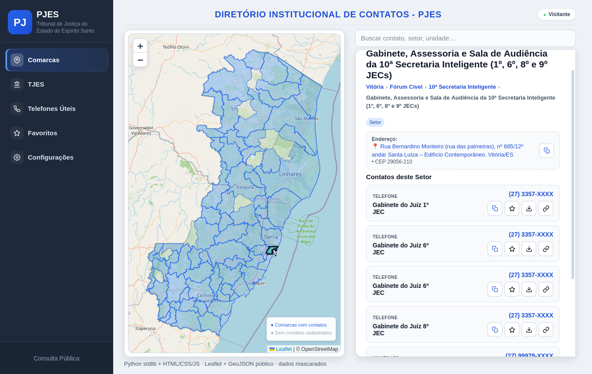
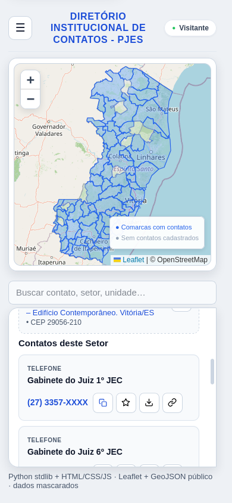

# Diretório de Contatos do PJES — evolução Python + SQLite

> Case real de estágio no TJES: o MVP original (Google Apps Script + Google
> Sheets) validou o fluxo a custo zero no ecossistema Workspace do tribunal;
> esta é a **fase 2 — reescrita em Python + SQLite**, com a mesma arquitetura
> e a mesma modelagem (consulta pública + área administrativa com login,
> permissões por nível, solicitações de acesso, registro de alterações e
> navegação em camadas Comarca → Fórum → Unidade → Setor com mapa).
>
> **Dados 100% fictícios** — comarcas reais do ES, fóruns/setores
> representativos; nomes de pessoas, telefones e e-mails inventados
> (`@exemplo.jus.br`). Nenhum dado real ou interno do tribunal é usado aqui.
> Versão corporativa completa (MVP original):
> [EnzoMoulin/diretorio-contatos](https://github.com/EnzoMoulin/diretorio-contatos).

## Arquitetura (espelha o sistema original)
- **Duas implantações isoladas, sem trânsito entre elas** — como no original
  (implantação pública no site × privada na intranet, definidas por propriedade):
  - `/` pública: só consulta; falha fechada (nenhuma mutação sem token)
  - `/admin` interna: portão de login; sem token válido, nada além do portão aparece
- **Portão institucional (simulado)**: no original, sessão Google + intranet + domínio
  institucional; aqui, qualquer conta Google entra como visitante, e a intranet
  é simulada pelo `INTRANET_ONLY` (só localhost/rede local alcança o `/admin`).
  A aprovação é automática nesta demonstração (`SIMULACAO_AUTO_APROVAR=1`,
  marcada como "SIMULAÇÃO AUTOMÁTICA"); produção = aprovação manual.
- **Tabela de usuários decide permissões**: sem cadastro, mesmo no interno a
  visão seria só consulta; com cadastro, edita os locais do seu escopo
  (`acessos`, com herança comarca > fórum > unidade > setor); admin edita tudo
- **Consulta em cards por nível**: sem tabela — Comarca → Fórum → Unidade →
  Setor em cards clicáveis com contagem, botão voltar e breadcrumb; contato em card
  com `tel:` + `mailto:`; Criar/Editar/Remover só onde há cobertura

## O que faz
- **Consulta pública** (`/`): **mapa clicável à esquerda como porta de entrada**
  (Leaflet + GeoJSON público do IBGE filtra por comarca) + **painel à direita**
  com busca global (alcança todos os níveis: nome, cargo, telefone, e-mail,
  setor, unidade, fórum e comarca) e **menus em cascata** Comarca → Fórum →
  Unidade → Setor, com breadcrumb do caminho. A tabela **começa vazia**, com orientação
  — nada de despejar todos os contatos de cara. Sem nenhum caminho para o acesso interno.
- **Acesso interno** (`/admin`, URL separada, sem nenhum caminho a partir do
  público): entra direto em **consulta** (mapa + cascata + tabela vazia), sem login e
  sem funções administrativas; logado, os locais liberados vêm marcados com ✓
  (consulta em todos, edição só no escopo); clicar no mapa filtra qualquer local.
  Botões na base da sidebar: **Acesso administrativo** (login com Google, sem
  senha — identidade igual ao privado do v1; com acesso aprovado, eleva e libera
  gestão por escopo + Solicitações + Registro), **Solicitar acesso** (primeiro
  acesso, só identidade) e **Solicitar locais** (árvore comarca > fórum >
  unidade > setor, para quem já tem cadastro); **Sair do acesso administrativo**
  volta à consulta, continua no interno e invalida a sessão no servidor.
  Primeiro login vira admin se não houver nenhum; o resto é liberado por
  aprovação (automática nesta demonstração).
- **Gestão dentro da consulta, com escopo por nível**: o usuário cria/edita/remove
  contatos só onde tem cobertura (comarca, fórum, unidade ou setor, com herança de
  cima); fora dela, só consulta. Ao lado de cada nível selecionado sem cobertura,
  botão **Solicitar acesso** com modal de confirmação dinâmico (comarca inteira
  = tudo abaixo; fórum inteiro = unidades e setores; unidade inteira = setores; setor = só ele).
  Admin aprova e a cobertura amplia. Servidor barra tudo fora do escopo (403).
- **Solicitação de acesso**: página em dois modos — primeiro acesso (só
  identidade) e locais (árvore comarca > fórum > unidade > setor); nome e motivo
  opcional → um pedido por local → aprovação automática nesta demonstração
  (marcada como simulação) ou manual pelo admin; o acesso libera na conta
  Google do solicitante. Servidor barra duplicata, excesso de pendentes e tudo
  fora do escopo (403).
- **Registro de alterações**: criar / editar / remover / pedidos / aprovações
- **Dashboard** (só logado): cards (comarcas, fóruns, unidades, setores, contatos,
  editáveis, pendências), barras por comarca com ✓ de cobertura e últimas
  alterações — tudo recortado pelo seu escopo
- **Notificações** (só logado): solicitações chegam aos admins, aprovação
  chega ao solicitante, criar/editar/remover avisa os admins; badge de não
  lidas, marcar uma/todas como lidas. A aba só aparece após o login.
- **Configurações**: tema claro/escuro para todo mundo (externo e interno,
  com ou sem login); logado ganha dados da conta (sem senha: identidade Google)
- **E-mails clicáveis**: toda coluna de e-mail abre o app de e-mail (mailto),
  igual ao original
- **Imprimir / Salvar PDF**: botão aparece após selecionar uma comarca e
  imprime todos os contatos do nível atual (comarca, fórum, unidade ou setor);
  Dashboard e Registro têm botão próprio; folha limpa em A4

## Stack
- Backend: Python 3, somente biblioteca padrão (`http.server` + `sqlite3`) — zero dependências
- Frontend: HTML + CSS + JS puro (sem framework); mapa com Leaflet via CDN
- Banco: SQLite local (`contatos.db`, criado na primeira execução, ~1900 registros da base mascarada + `seed_pjes.json` versionado)

## Como rodar
```bash
python3 app.py
# pública: http://localhost:8000
# admin:   http://localhost:8000/admin   (login com Google; primeiro vira admin)
bash teste_rapido.sh   # verifica o fluxo completo, incl. escopo por local
python3 -m unittest tests.test_regras -v   # regras de negócio (IDs, pedido, herança)
```

## Como avaliar este demo (2 minutos)
1. Abra `/admin` e entre com qualquer conta Google → você entra como visitante.
2. Peça acesso em **Solicitar acesso** → liberação automática (simulação).
3. Peça locais em **Solicitar locais** (marque a caixa de Administrador para ver a parte administrativa).
4. No projeto real, os passos 2–3 aguardam aprovação manual de um Administrador — aqui é automático só para você testar sem depender de ninguém.

## E-mail de verdade (opcional)
Sem SMTP configurado, os avisos ficam só dentro do sistema. Para enviar de
verdade (Gmail), crie uma **senha de app** em
conta Google → Segurança → Verificação em 2 etapas → Senhas de app, e rode:
```bash
SMTP_HOST=smtp.gmail.com SMTP_PORT=587 \
SMTP_USER=seu@gmail.com SMTP_PASS=xxxx-xxxx-xxxx-xxxx \
SMTP_FROM=seu@gmail.com NOTIFY_EMAILS=seu@gmail.com \
python3 app.py
```
O que é enviado: pedido novo → admins (`NOTIFY_EMAILS` + contas admin);
aprovação → solicitante. Falha de envio nunca quebra o fluxo.

## Endpoints
| Método | Rota | Auth | Descrição |
|---|---|---|---|
| GET | `/api/comarcas` | não | comarcas + contagens |
| GET | `/api/foruns?comarca_id=` | não | fóruns da comarca |
| GET | `/api/unidades?forum_id=` | não | unidades do fórum |
| GET | `/api/setores?unidade_id=` | não | setores da unidade |
| GET | `/api/contatos?q=&setor_id=&unidade_id=&forum_id=&comarca_id=` | não | lista/busca com escopo |
| GET | `/api/me` | `X-Admin-Token` | usuário + flag admin + escopo |
| GET | `/api/historico` | `X-Admin-Token` | últimas 50 alterações |
| GET | `/oauth/login` | não | inicia login com Google |
| GET | `/oauth/callback` | não | retorno do Google → sessão |
| POST | `/api/logout` | token | encerra a sessão |
| POST | `/api/login` | não | legado `{usuario, senha}` → `{token}` |
| POST | `/api/contatos` | `X-Admin-Token` | cria (só no seu escopo) |
| DELETE | `/api/contatos/<id>` | `X-Admin-Token` | remove (só no seu escopo) |
| POST | `/api/pedidos` | não | solicita acesso (com local) |
| GET | `/api/pedidos` | `X-Admin-Token` | pendentes (com local pedido) |
| POST | `/api/pedidos/<id>/aprovar` | `X-Admin-Token` | aprova, cria usuário e concede escopo |
| GET | `/api/resumo` | `X-Admin-Token` | totais por fórum/unidade/setor + últimos 5 + pendentes |
| POST | `/api/me/senha` | `X-Admin-Token` | troca a própria senha |
| GET | `/api/notificacoes` | `X-Admin-Token` | minhas notificações + `nao_lidas` |
| POST | `/api/notificacoes/lida` | `X-Admin-Token` | marca uma como lida (`{"id"}`) |
| POST | `/api/notificacoes/lidas` | `X-Admin-Token` | marca todas como lidas |

## Fase 1 — MVP corporativo (Google Apps Script)
Mesma arquitetura, implementação validada no ecossistema Workspace
(auth Google, papéis, hierarquia, auditoria):
[EnzoMoulin/diretorio-contatos](https://github.com/EnzoMoulin/diretorio-contatos).

## Screenshots



## Experiência de uso (detalhes)
- **Favoritos** (aba na sidebar + estrela em cada contato, com contador): salvos no navegador, em ordem A–Z, com filtro próprio, impressão, exportação CSV, download de todos em um `.vcf` e limpeza com confirmação
- **Baixar contato (.vcf)**: cada contato gera o cartão para importar na agenda do celular
- **Link direto**: cada contato tem URL `?contato=id` que abre direto nele com destaque; no celular abre o menu de compartilhar do sistema
- **Exportar CSV**: botão junto ao imprimir baixa Nome;Tipo;Valor do que está na tela (com BOM para o Excel)
- **Busca de verdade**: `/` foca o campo, setas navegam, Enter abre, Esc fecha; termo grifado nos resultados e semântica de combobox para leitor de tela; opção ativa anunciada
- **Mobile de verdade**: até 900px a sidebar vira gaveta (hambúrguer por vista, fecha no Esc e ao trocar de aba) e o mapa ganha altura mínima — validado em render headless 390px
- **Acessibilidade medida**: pares de cor auditados no WCAG AA (4.5+), anel de foco visível, skip-link para o conteúdo, `reduced-motion` respeitado em tudo, favicon e `theme-color`
- **Impressão limpa**: cabeçalho com data/hora de geração; fixos da tela (skip-link, avisos) não saem no papel

## Estrutura
```
app.py                 backend + API (stdlib, com escopo por local)
frontend/public.html   consulta pública (busca + camadas + mapa + modal)
frontend/public.js     lógica da consulta pública
frontend/admin.html    área administrativa (consulta + modais)
frontend/admin.js      estados de acesso + gestão por escopo + solicitações + registro
frontend/mapa.js       mapa Leaflet compartilhado (densidade + clique filtra)
frontend/style.css     tema (identidade do app original)
```

## Licença
MIT — Enzo Moulin.
