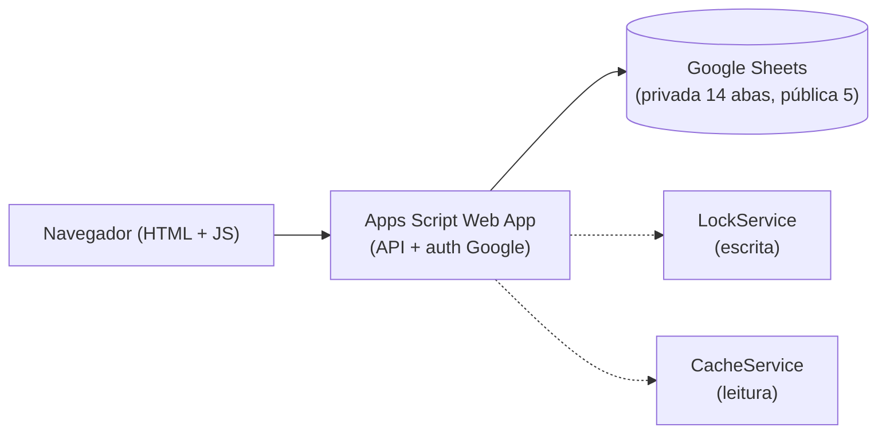
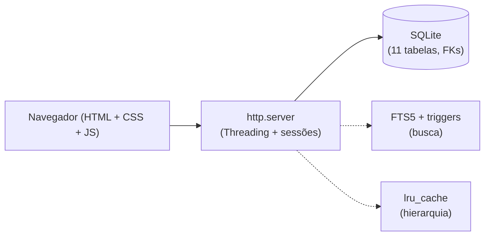
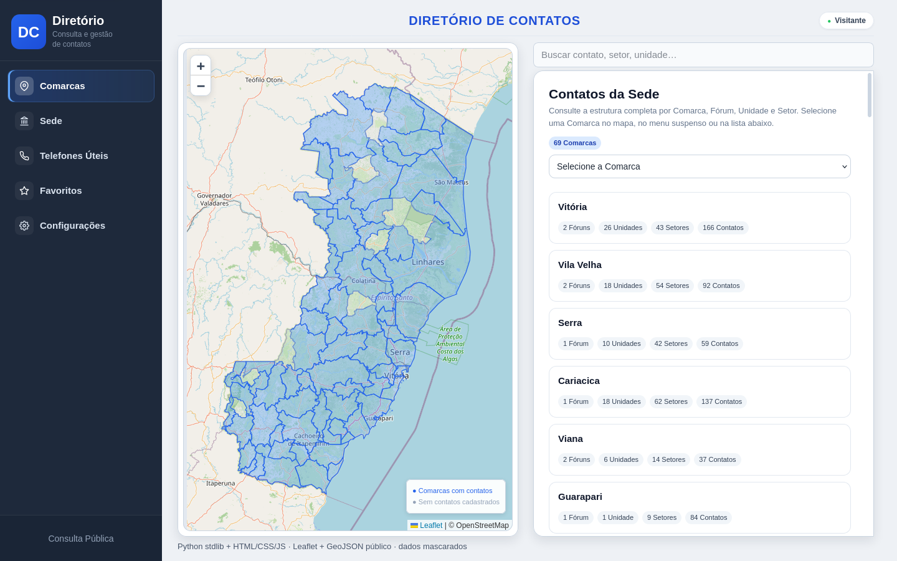
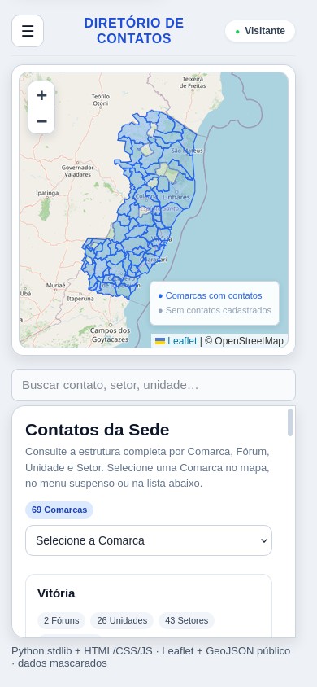
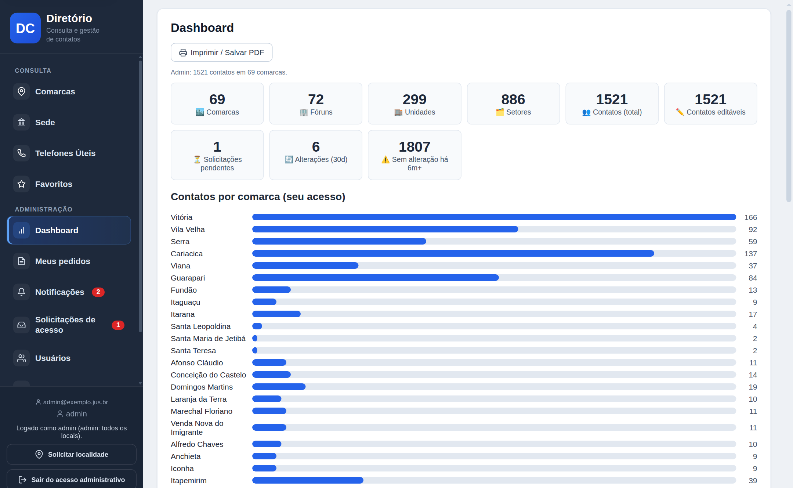
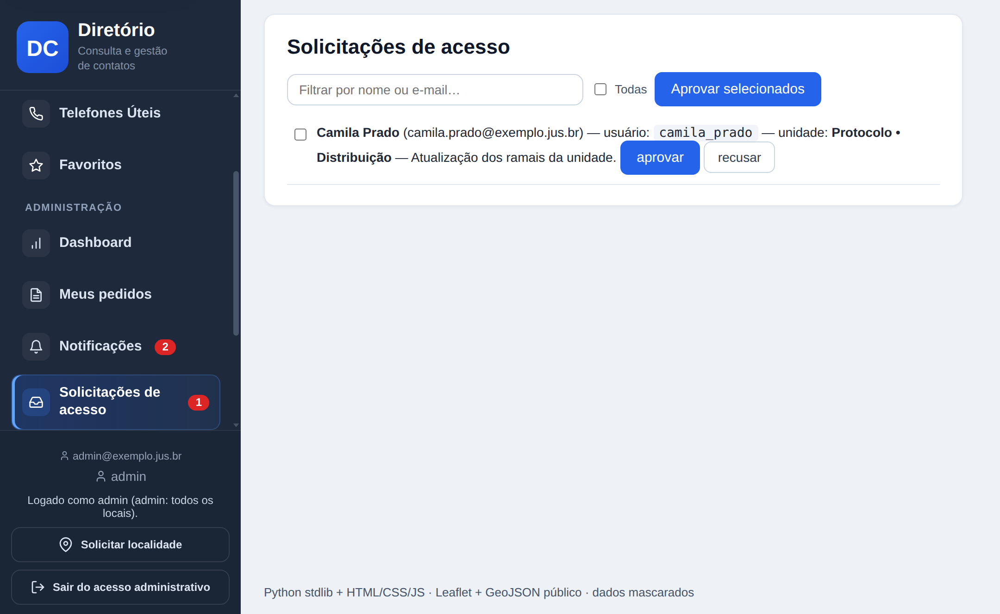
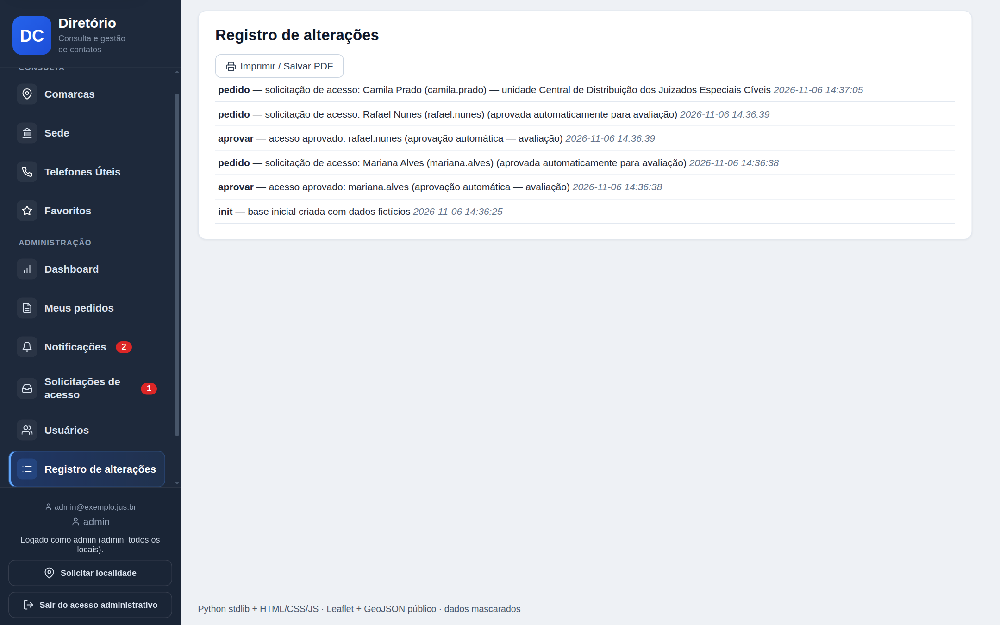

# Diretório de Contatos — evolução Python + SQLite

[](https://github.com/EnzoMoulin/diretorio-contatos-v2/actions)
[](https://www.python.org/downloads/)
<!-- Manutenção: ao subir o PYTHON_VERSION no render.yaml, trocar esta série (3.15) aqui e em docs/cartilha-deploy.html. -->

> Case real de estágio em tribunal estadual: o MVP original (Google Apps Script + Google
> Sheets) validou o fluxo a custo zero no ecossistema Workspace do tribunal;
> esta é a **fase 2 — reescrita em Python + SQLite**, com a mesma arquitetura
> e a mesma modelagem (consulta pública + área administrativa com login,
> permissões por nível, solicitações de acesso, registro de alterações e
> navegação em camadas Comarca → Fórum → Unidade → Setor com mapa).
>
> **Dados mascarados** — estrutura organizacional baseada em informação
> pública (comarcas reais do ES); nomes de pessoas e e-mails fictícios
> (`@exemplo.jus.br`); telefones com os 4 últimos dígitos ocultos. Nenhum dado
> real ou interno do tribunal é usado aqui.
> Fase 1 — MVP corporativo (Google Apps Script + Sheets): repositório privado
> (código institucional); o arco técnico está documentado abaixo, em
> [Estudo de caso](#estudo-de-caso-v1--v2--v3).

## Evolução v1 → v2 → v3
Mesmo produto, três fases de maturidade — a interface e as regras de negócio
são as mesmas; o que evolui é a fundação técnica:

| Aspecto | v1 — MVP (privado) | v2 — reescrita (este repo) | v3 — direção |
|---|---|---|---|
| Runtime + dados | Apps Script + Sheets (planilha como banco, sem FKs) | Python stdlib + SQLite (FKs, zero dependências) | Migrações versionadas, Postgres opcional |
| Concorrência | `LockService` por execução | `ThreadingHTTPServer` + lock em escrita | Servidor ASGI, pool de conexões |
| Busca | Substring no frontend | FTS5 no servidor + autocomplete com highlight | Ranking por relevância, tolerância a erro de digitação |
| Auth | Sessão Google + planilha | Google OAuth + login local (só dev, flag `LOCAL_LOGIN`) com PBKDF2 | Expiração de sessão, papéis granulares |
| Backup | Versionamento nativo da planilha | `VACUUM INTO` com download no admin | Rotina agendada com retenção |
| Cache | `CacheService` com TTL | `lru_cache` na hierarquia (invalidado em escrita) | Cache por escopo de usuário |
| Saúde dos dados | Validador manual de integridade | Dashboard: alterações 30d + obsoletos 180d | Alertas automáticos de obsolescência |
| Testes | Sem testes automatizados | 27 testes (`unittest`, banco temporário) + CI no GitHub Actions | Cobertura medida e testes de contrato da API |
| Hospedagem | Apps Script Web App publicado (`/exec`) | Render free — web service único, disco efêmero | Front estático (Cloudflare Pages) + API FastAPI separada: a página abre na hora, a API acorda sozinha |

Por que três fases em vez de reescrever direto: o v1 validou o produto a custo
zero dentro do ecossistema onde os dados viviam; o v2 prova a mesma arquitetura
sem dependência de fornecedor; o v3 endurece para escala.

## Estudo de caso: v1 → v2 → v3

O v1 foi o MVP cuja proposta e entrega foram avaliadas e aprovadas no órgão;
o piloto foi então lançado para testes internos (Google Apps Script +
Sheets, repositório privado por ser código institucional). O v2 é a reescrita
do backend em Python, com a mesma modelagem e a mesma experiência. O que segue
é o arco técnico: decisões, o que mudou e por quê.

### Fase 1 — MVP no ecossistema (Apps Script + Sheets)



- **Decisão central:** planilha como banco — custo zero, zero infraestrutura, e os
  dados já viviam no Workspace do tribunal. Frontend e backend conversando em JSON.
- **O que segurou o piloto:** `LockService` em escrita, cache de referência com TTL,
  autorização sempre no servidor.
- **Limites que motivaram a v2:** planilha não tem chaves estrangeiras nem testes
  automatizados; tudo preso ao ecossistema Google; sem como provar a arquitetura
  fora dele.

### Fase 2 — reescrita em Python stdlib + SQLite



- **Reescrito do zero:** backend Python só-stdlib (`http.server` + `sqlite3`), seed
  mascarado versionado, FTS5 com triggers, senhas em PBKDF2, backup `VACUUM INTO`,
  `lru_cache` com invalidação, 27 testes (`unittest`, banco temporário).
- **Portado fiel:** fluxo de navegação (Comarca → Fórum → Unidade → Setor), regras de
  escopo por nível, UX das telas — a interface e as regras são as mesmas, propositalmente.
- **Por que só stdlib:** zero dependências = deploy gratuito trivial e prova de que a
  arquitetura se sustenta sem fornecedor.

### Fase 3 — direção (endurecer para escala)

Migrações versionadas, Postgres opcional, papéis granulares (RBAC), paginação,
ranking de busca com tolerância a erro de digitação.

## Arquitetura
- **Duas implantações isoladas, sem trânsito entre elas** — pública e
  administrativa, separadas por configuração de ambiente:
  - `/` pública: só consulta; falha fechada (nenhuma mutação sem token)
  - `/admin` interna: portão de login; sem token válido, nada além do portão aparece
- **Portão de acesso (para avaliação)**: login por conta Google; qualquer conta
  entra como visitante, e o `/admin` pode ser restrito à rede local com
  `INTRANET_ONLY=1` (no demo público fica `0`, e o portão é o login).
  O demo público é **somente leitura** (`SIMULACAO_AUTO_APROVAR=0`): pedido de
  acesso fica pendente e só o dono aprova. Rodando localmente com
  `SIMULACAO_AUTO_APROVAR=1` a aprovação é automática, sinalizada na tela.
- **Tabela de usuários decide permissões**: sem cadastro, mesmo no interno a
  visão seria só consulta; com cadastro, edita os locais do seu escopo
  (`acessos`, com herança comarca > fórum > unidade > setor); admin edita tudo
- **Consulta em cards por nível**: sem tabela — Comarca → Fórum → Unidade →
  Setor em cards clicáveis com contagem, botão voltar e breadcrumb; contato em card
  com `tel:` + `mailto:`; Criar/Editar/Remover só onde há cobertura

## O que faz
- **Consulta pública** (`/`): **mapa clicável à esquerda como porta de entrada**
  (Leaflet + GeoJSON público do IBGE filtra por comarca) + **painel à direita**
  com busca global (alcança todos os níveis: nome, cargo, telefone, e-mail,
  setor, unidade, fórum e comarca) e **menus em cascata** Comarca → Fórum →
  Unidade → Setor, com breadcrumb do caminho. A tabela **começa vazia**, com orientação
  — nada de despejar todos os contatos de cara. Sem nenhum caminho para o acesso interno.
- **Acesso interno** (`/admin`, URL separada, sem nenhum caminho a partir do
  público): entra direto em **consulta** (mapa + cascata + tabela vazia), sem login e
  sem funções administrativas; logado, os locais liberados vêm marcados com ✓
  (consulta em todos, edição só no escopo); clicar no mapa filtra qualquer local.
  Botões na base da sidebar: **Acesso administrativo** (login com Google, sem
  senha; com acesso aprovado, eleva e libera
  gestão por escopo + Solicitações + Registro), **Solicitar acesso** (primeiro
  acesso, só identidade) e **Solicitar locais** (árvore comarca > fórum >
  unidade > setor, para quem já tem cadastro); **Sair do acesso administrativo**
  volta à consulta, continua no interno e invalida a sessão no servidor.
  Primeiro login entra como visitante; o perfil de Administrador não é pedido
  pela tela: ele vem apenas da allowlist `ADMIN_EMAILS` do dono do ambiente.
- **Gestão dentro da consulta, com escopo por nível**: o usuário cria/edita/remove
  contatos só onde tem cobertura (comarca, fórum, unidade ou setor, com herança de
  cima); fora dela, só consulta. Ao lado de cada nível selecionado sem cobertura,
  botão **Solicitar acesso** com modal de confirmação dinâmico (comarca inteira
  = tudo abaixo; fórum inteiro = unidades e setores; unidade inteira = setores; setor = só ele).
  Admin aprova e a cobertura amplia. Servidor barra tudo fora do escopo (403).
- **Solicitação de acesso**: página em dois modos — primeiro acesso (só
  identidade) e locais (árvore comarca > fórum > unidade > setor); nome e motivo
  opcional → um pedido por local → aprovação pelo administrador (no demo
  público é manual, porque o ambiente é somente leitura) ou automática, quando
  o servidor roda com `SIMULACAO_AUTO_APROVAR=1`; o acesso libera na conta
  Google do solicitante. Servidor barra duplicata, excesso de pendentes e tudo
  fora do escopo (403).
- **Registro de alterações**: criar / editar / remover / pedidos / aprovações
- **Dashboard** (só admin): cards (comarcas, fóruns, unidades, setores, contatos,
  editáveis, pendências), barras por comarca com ✓ de cobertura e últimas
  alterações — tudo recortado pelo seu escopo
- **Notificações** (só logado): solicitações chegam aos admins, aprovação
  chega ao solicitante, criar/editar/remover avisa os admins; badge de não
  lidas, marcar uma/todas como lidas. A aba só aparece após o login.
- **Configurações**: tema claro/escuro para todo mundo (externo e interno,
  com ou sem login); logado ganha dados da conta (sem senha: identidade Google)
- **E-mails clicáveis**: toda coluna de e-mail abre o app de e-mail (mailto)
- **Imprimir / Salvar PDF**: botão aparece após selecionar uma comarca e
  imprime todos os contatos do nível atual (comarca, fórum, unidade ou setor);
  Dashboard e Registro têm botão próprio; folha limpa em A4

## Stack
- Backend: Python **3.15.2** — versão exata do demo, fixada em `render.yaml` (`PYTHON_VERSION`) e
  testada pelo CI —, somente biblioteca padrão (`http.server` + `sqlite3`) — zero dependências
- Frontend: HTML + CSS + JS puro (sem framework); mapa com Leaflet via CDN
- Banco: SQLite local (`contatos.db`, criado na primeira execução) com 1.807 contatos
  (1.521 nas 69 comarcas e 286 da estrutura central), vindos da base mascarada versionada

## Como rodar
```bash
SIMULACAO_AUTO_APROVAR=1 ADMIN_EMAILS=seu@gmail.com python3 app.py
# pública: http://localhost:8000
# admin:   http://localhost:8000/admin   (login Google; admin só p/ e-mail em ADMIN_EMAILS)
bash teste_rapido.sh   # imprime os códigos do fluxo completo (não é teste automatizado;
                       # atenção: encerra qualquer processo na porta 8000)
python3 -m unittest discover -s tests -t . -v   # 27 testes (servidor no ar + ADMIN_EMAILS na env; sem ela, 2 são pulados)
```
Os testes batem na API por HTTP e assumem o modo de avaliação
(`SIMULACAO_AUTO_APROVAR=1`), por isso o servidor precisa subir com a variável —
é o mesmo env que o CI usa.

## Hospedagem (pôr no ar)
Só stdlib: sem `pip install`. No Render (gratuito): novo Web Service a partir
do repo (`render.yaml` já traz `INTRANET_ONLY=0`, `LOCAL_LOGIN=0`,
`SIMULACAO_AUTO_APROVAR=0` — somente leitura). `PORT` vem do ambiente. O health check do Render usa
`/healthz`, que responde 200 sem tocar no banco: assim um seed lento não é lido como
serviço morto (o que reiniciaria o processo e recriaria o banco). O banco é recriado do
seed mascarado a cada boot limpo (disco efêmero, sem como persistir no plano
gratuito) — como o demo é somente leitura, a vitrine sempre abre íntegra; só
usuários, pedidos e aprovações não sobrevivem ao restart. O plano free dorme depois de 15 minutos sem tráfego e leva cerca de 1 minuto
para acordar. A espera é **por serviço**: manter um único app no ar resolve a
cota (750 h de instância por mês por workspace, e um serviço sempre ativo já
consome ~730 h), não o cold start. Daí o aviso: o primeiro acesso pode levar um
minuto — os seguintes são imediatos.

> **Sucessor:** quando o v3 (FastAPI + Postgres, com o front estático separado
> da API) entrar no ar, este serviço será **suspenso** — não apagado — e o v3
> ocupa o lugar. Este repositório continua público, e este README passará a
> apontar para o v3.

`ADMIN_EMAILS` (definir no dashboard; é o e-mail Google que vira admin): sem
ela ninguém é admin — o primeiro login **não** ganha gestão. O link para
divulgar é `/` (página pública, sem login); `/admin` depende de conta Google e,
com a tela de consentimento OAuth em "Testing", só entram os usuários de teste
cadastrados no projeto do Google Cloud.

### Postura do demo público
- `SIMULACAO_AUTO_APROVAR=0` no demo: o ambiente é **somente leitura** — pedido
  de acesso fica pendente e só o dono aprova, em `/admin → Solicitações`. O `1`
  existe para rodar localmente e para os testes, onde aprova na hora e a tela
  sinaliza que foi automático.
- Admin nunca vem de "primeiro login": só da allowlist `ADMIN_EMAILS`.
- Banco efêmero: `contatos.db` nasce do seed a cada boot e usuários/aprovações
  não sobrevivem ao restart. No plano gratuito não há disco para persistir, e um
  banco externo exigiria driver fora da biblioteca padrão.

Login com Google em produção precisa de um client OAuth tipo **Web**:
1. No [Google Cloud Console](https://console.cloud.google.com/) crie um ID do
   cliente OAuth (tipo Web) com origem `https://<seu-app>.onrender.com` e
   redirect `https://<seu-app>.onrender.com/oauth/callback`.
2. No dashboard do Render, defina as variáveis `GOOGLE_CLIENT_JSON` (o JSON do
   client) e `APP_BASE_URL` (a URL pública) — o `redirect_uri` já sai em
   `https` atrás do proxy. Sem isso, o `/oauth/login` responde 500 explicando.
   Tela de consentimento não verificada mostra aviso do Google — esperado fora de produção.

## Como avaliar (2 minutos)
1. Abra a página pública `/` (sem login): clique no mapa, use a busca, favorite e imprima um contato.
2. Navegue comarca → fórum → unidade → setor: a consulta é o produto, e a árvore abre no nível que você clicar.
3. O `/admin` (login Google) é restrito ao dono e o demo é **somente leitura**: um pedido de acesso fica pendente, esperando aprovação manual, como em produção. As telas de gestão — painel, solicitações com pedido pendente, registro de alterações, usuários — estão nas capturas abaixo.
4. Para ver o fluxo ao vivo (login, aprovação, edição com registro), me chame no LinkedIn ([linkedin.com/in/enzodadaltomoulin](https://linkedin.com/in/enzodadaltomoulin)).

Privacidade: o demo guarda o e-mail e o nome da sua conta Google só enquanto o servidor estiver ativo; o banco é recriado do seed a cada boot limpo, então esses dados somem no reinício.

## E-mail de verdade (opcional)
Sem SMTP configurado, os avisos ficam só dentro do sistema. Para enviar de
verdade (Gmail), crie uma **senha de app** em
conta Google → Segurança → Verificação em 2 etapas → Senhas de app, e rode:
```bash
SMTP_HOST=smtp.gmail.com SMTP_PORT=587 \
SMTP_USER=seu@gmail.com SMTP_PASS=xxxx-xxxx-xxxx-xxxx \
SMTP_FROM=seu@gmail.com NOTIFY_EMAILS=seu@gmail.com \
python3 app.py
```
O que é enviado: pedido novo → admins (`NOTIFY_EMAILS` + contas admin);
aprovação → solicitante. Falha de envio nunca quebra o fluxo.

## Login local (só dev/testes)
O login por usuário/senha (`/api/login`, `admin`/`admin123`) existe para testes
automatizados e avaliação sem Google. `admin`/`admin123` são credenciais de
demonstração: ficam desativadas no deploy, que roda com `LOCAL_LOGIN=0` (as
rotas somem com 404). As senhas usam PBKDF2-HMAC-SHA256
com salt; hashes sha256 legados são convertidos no primeiro login.

## Endpoints
| Método | Rota | Auth | Descrição |
|---|---|---|---|
| GET | `/api/comarcas` | não | comarcas + contagens |
| GET | `/api/foruns?comarca_id=` | não | fóruns da comarca |
| GET | `/api/unidades?forum_id=` | não | unidades do fórum |
| GET | `/api/setores?unidade_id=` | não | setores da unidade |
| GET | `/api/contatos?q=&setor_id=&unidade_id=&forum_id=&comarca_id=` | não | lista/busca com escopo |
| GET | `/api/me` | `X-Admin-Token` | usuário + flag admin + escopo |
| GET | `/api/historico` | `X-Admin-Token` (admin) | últimas 50 alterações |
| GET | `/oauth/login` | não | inicia login com Google |
| GET | `/oauth/callback` | não | retorno do Google → sessão |
| POST | `/api/logout` | token | encerra a sessão |
| POST | `/api/login` | não | dev/testes `{usuario, senha}` → `{token}` (só `LOCAL_LOGIN=1`) |
| POST | `/api/contatos` | `X-Admin-Token` | cria (só no seu escopo) |
| DELETE | `/api/contatos/<id>` | `X-Admin-Token` | remove (só no seu escopo) |
| POST | `/api/pedidos` | token | solicita acesso (com local) |
| GET | `/api/pedidos` | `X-Admin-Token` (admin) | pendentes (com local pedido) |
| POST | `/api/pedidos/<id>/aprovar` | `X-Admin-Token` (admin) | aprova, cria usuário e concede escopo |
| POST | `/api/pedidos/<id>/recusar` | `X-Admin-Token` (admin) | recusa com motivo (notifica + e-mail) |
| GET | `/api/meus-pedidos` | `X-Admin-Token` | meus pedidos + motivo de recusa |
| GET | `/api/usuarios` | `X-Admin-Token` (admin) | usuários + último login + nº de locais |
| POST | `/api/usuarios/<id>/ativo` | `X-Admin-Token` (admin) | ativa/desativa (`{"ativo":0/1}`) |
| GET | `/api/busca?q=` | não | busca FTS5 com highlight (autocomplete) |
| POST | `/api/backup` | `X-Admin-Token` (admin) | gera `backups/diretorio-*.db` (VACUUM INTO) |
| GET | `/api/backup/<arq>` | `X-Admin-Token` (admin) | baixa o `.db` gerado |
| GET | `/api/resumo` | `X-Admin-Token` (admin) | totais por fórum/unidade/setor + últimos 5 + pendentes + saúde |
| POST | `/api/me/senha` | `X-Admin-Token` | troca a própria senha (só `LOCAL_LOGIN=1`) |
| GET | `/api/notificacoes` | `X-Admin-Token` | minhas notificações + `nao_lidas` |
| POST | `/api/notificacoes/lida` | `X-Admin-Token` | marca uma como lida (`{"id"}`) |
| POST | `/api/notificacoes/lidas` | `X-Admin-Token` | marca todas como lidas |

## Fase 1 — MVP corporativo (Google Apps Script)
Implementação validada no ecossistema Workspace (auth Google, papéis,
hierarquia, auditoria). Repositório privado (código institucional) — o arco
técnico está documentado acima, em
[Estudo de caso](#estudo-de-caso-v1--v2--v3).

## Screenshots



### Área administrativa (dono do demo)


<sub>Captura de **Solicitações de acesso** com um pedido fictício
(`camila.prado@exemplo.jus.br`, nível unidade) pendente — é o comportamento do
demo público, que sobe com `SIMULACAO_AUTO_APROVAR=0`: o pedido espera a
aprovação do dono, e só a aprovação concede edição. A imagem foi feita em
ambiente local, com o login `admin` de teste.</sub>



## Experiência de uso (detalhes)
- **Favoritos** (aba na sidebar + estrela em cada contato, com contador): salvos no navegador, em ordem A–Z, com filtro próprio, impressão, exportação CSV, download de todos em um `.vcf` e limpeza com confirmação
- **Baixar contato (.vcf)**: cada contato gera o cartão para importar na agenda do celular
- **Link direto**: cada contato tem URL `?contato=id` que abre direto nele com destaque; no celular abre o menu de compartilhar do sistema
- **Exportar CSV**: botão junto ao imprimir baixa Nome;Tipo;Valor do que está na tela (com BOM para o Excel)
- **Busca de verdade**: `/` foca o campo, setas navegam, Enter abre, Esc fecha; termo grifado nos resultados e semântica de combobox para leitor de tela; opção ativa anunciada
- **Mobile de verdade**: até 900px a sidebar vira gaveta (hambúrguer por vista, fecha no Esc e ao trocar de aba) e o mapa ganha altura mínima — validado em render headless 390px
- **Acessibilidade medida**: pares de cor auditados no WCAG AA (4.5+), anel de foco visível, skip-link para o conteúdo, `reduced-motion` respeitado em tudo, favicon e `theme-color`
- **Impressão limpa**: cabeçalho com data/hora de geração; fixos da tela (skip-link, avisos) não saem no papel

## Estrutura
```
app.py                 backend + API (stdlib, com escopo por local)
frontend/public.html   consulta pública (busca + camadas + mapa + modal)
frontend/public.js     lógica da consulta pública
frontend/admin.html    área administrativa (consulta + modais)
frontend/admin.js      estados de acesso + gestão por escopo + solicitações + registro
frontend/mapa.js       mapa Leaflet compartilhado (densidade + clique filtra)
frontend/style.css     tema (paleta, tipografia e componentes)
```

## Licença
© Enzo Moulin — todos os direitos reservados. Projeto de portfólio: sem licença
de uso, cópia ou redistribuição. Os termos completos estão em [`LICENSE`](LICENSE).
