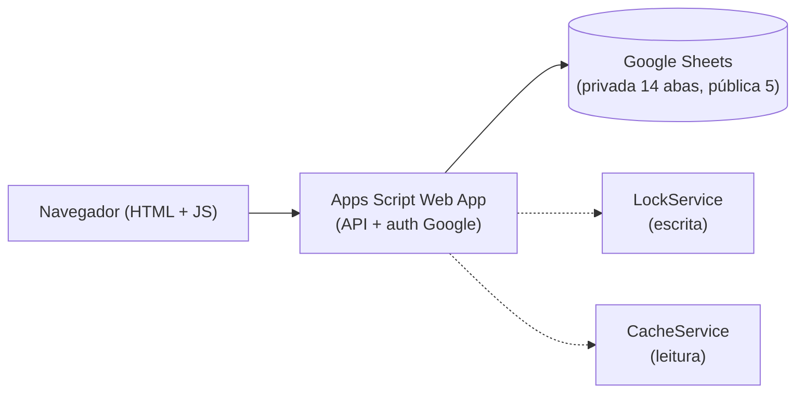
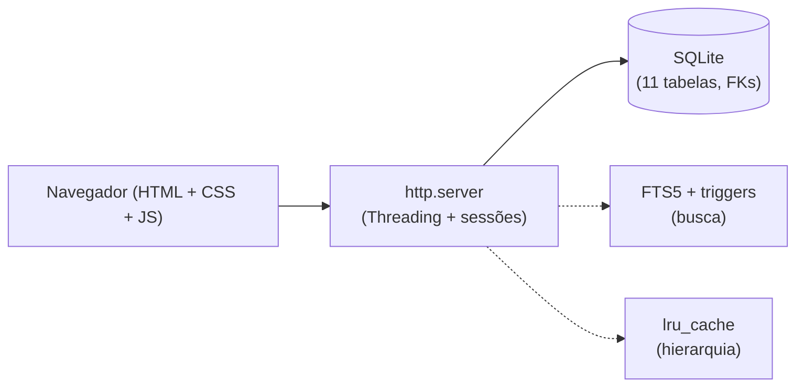

# Diretório de Contatos — evolução Python + SQLite

[](https://github.com/EnzoMoulin/diretorio-contatos-v2/actions)
[](https://www.python.org/downloads/)
<!-- Manutenção: ao subir o PYTHON_VERSION no render.yaml, trocar esta série (3.15) aqui e em docs/cartilha-deploy.html. -->

> Case real de estágio em tribunal estadual: o MVP original (Google Apps Script + Google
> Sheets) validou o fluxo a custo zero no ecossistema Workspace do tribunal;
> esta é a **fase 2 — reescrita em Python + SQLite**, com a mesma arquitetura
> e a mesma modelagem (consulta pública + área administrativa com login,
> permissões por nível, solicitações de acesso, registro de alterações e
> navegação em camadas Comarca → Fórum → Unidade → Setor com mapa).
>
> **Dados mascarados** — estrutura organizacional baseada em informação
> pública (comarcas reais do ES); nomes de pessoas e e-mails fictícios
> (`@exemplo.jus.br`); telefones com os 4 últimos dígitos ocultos. Nenhum dado
> real ou interno do tribunal é usado aqui.
> Fase 1 — MVP corporativo (Google Apps Script + Sheets): repositório privado
> (código institucional); o arco técnico está documentado abaixo, em
> [Estudo de caso](#estudo-de-caso-v1--v2--v3).

## Estudo de caso: v1 → v2 → v3
Mesmo produto, três fases de maturidade — a interface e as regras de negócio
são as mesmas; o que evolui é a fundação técnica. A tabela é o resumo; o arco
completo, com as decisões e o que cada fase custou, vem em seguida.

| Aspecto | v1 — MVP (privado) | v2 — reescrita (este repo) | v3 — direção |
|---|---|---|---|
| Runtime + dados | Apps Script + Sheets (planilha como banco, sem FKs) | Python stdlib + SQLite (FKs, zero dependências) | Migrações versionadas + Postgres gerenciado (Neon) |
| Concorrência | `LockService` por execução | `ThreadingHTTPServer` + lock em escrita | PHP-FPM atrás do nginx, pool de conexões |
| Busca | Substring no frontend | FTS5 no servidor + autocomplete com highlight | Ranking por relevância, tolerância a erro de digitação |
| Auth | Sessão Google + planilha | Google OAuth + login local (só dev, `LOCAL_LOGIN`) com PBKDF2 | Expiração de sessão, papéis granulares |
| Testes | Sem testes automatizados | 94 casos (`unittest`, banco temporário) + fumaça Playwright + CI em duas pernas | Cobertura medida e testes de contrato |
| Hospedagem | Apps Script Web App publicado (`/exec`) | Render free — web service único, disco efêmero | Laravel + Blade/TALL num serviço Docker + Postgres gerenciado |

Por que três fases em vez de reescrever direto: o v1 validou o produto a custo
zero dentro do ecossistema onde os dados viviam; o v2 prova a mesma arquitetura
sem dependência de fornecedor; o v3 endurece para escala.

O v1 nasceu como proposta de estágio no Laboratório de Inovação e IA do
Tribunal de Justiça do Estado do Espírito Santo (TJES): a proposta e o MVP
foram apresentados e aprovados, e o piloto entrou em testes internos (Google
Apps Script + Sheets, repositório privado por ser código institucional; lá o
sistema atendia pelo nome PJES, sigla que deu nome ao arquivo de seed até a
limpeza do histórico, quando ele virou `seed_legado.json`).
O v2 é a reescrita do backend em Python, com a mesma modelagem e a mesma
experiência: projeto pessoal, sem marca institucional, sem nome de pessoa e
com dados fictícios. As duas interfaces, a pública e a de gestão (`/admin`),
partem das telas do v1; o `/admin` é a mesma aplicação, com as telas de gestão
a mais. O que segue é o arco técnico: decisões, o que mudou e por quê.

### Fase 1 — MVP no ecossistema (Apps Script + Sheets)



- **Decisão central:** planilha como banco — custo zero, zero infraestrutura, e os
  dados já viviam no Workspace do tribunal; front e back conversando em JSON.
- **O que segurou o piloto:** `LockService` em escrita, cache com TTL, autorização
  sempre no servidor.
- **Limite que motivou a v2:** planilha não tem chave estrangeira nem teste, e tudo
  ficava preso ao ecossistema Google — sem como provar a arquitetura fora dele.

### Fase 2 — reescrita em Python stdlib + SQLite



- **Reescrito do zero:** `http.server` + `sqlite3`, seed mascarado versionado, FTS5
  com triggers, PBKDF2, `VACUUM INTO` com download no admin, `lru_cache` com
  invalidação, painel de alterações e obsoletos, 94 casos de teste em banco
  temporário e fumaça do admin num Chromium real (nos dois modos de aprovação).
- **Portado fiel:** fluxo Comarca → Fórum → Unidade → Setor, regras de escopo por
  nível e UX das telas — iguais de propósito.
- **Por que só stdlib:** zero dependência = deploy gratuito trivial e prova de que a
  arquitetura se sustenta sem fornecedor.

### Fase 3 — direção (endurecer para escala)

Laravel + TALL num serviço Docker, Postgres gerenciado, migrações versionadas, papéis
granulares, paginação e ranking de busca tolerante a erro de digitação.

## Arquitetura
- **Duas implantações isoladas, sem trânsito entre elas** — pública e
  administrativa, separadas por configuração de ambiente:
  - `/` pública: só consulta; falha fechada (nenhuma mutação sem token)
  - `/admin` interna: portão de login; sem token válido, nada além do portão aparece
- **Portão de acesso (para avaliação)**: login por conta Google; qualquer conta
  entra como visitante, e o `/admin` pode ser restrito à rede local com
  `INTRANET_ONLY=1` (no demo público fica `0`, e o portão é o login).
  O demo público é **somente leitura** (`SIMULACAO_AUTO_APROVAR=0`): pedido de
  acesso fica pendente e só o dono aprova. Rodando localmente com
  `SIMULACAO_AUTO_APROVAR=1` a aprovação é automática, sinalizada na tela.
- **Tabela de usuários decide permissões**: sem cadastro, mesmo no interno a
  visão seria só consulta; com cadastro, edita os locais do seu escopo
  (`acessos`, com herança comarca > fórum > unidade > setor); admin edita tudo
- **Consulta em cards por nível**: sem tabela — Comarca → Fórum → Unidade →
  Setor em cards clicáveis com contagem, botão voltar e breadcrumb; contato em card
  com `tel:` + `mailto:`; Criar/Editar/Remover só onde há cobertura

## O que faz
- **Procedência de cada contato**: quando existe documento, o contato carrega **de onde veio** (`fonte`)
  e **de quando é** (`vigente_desde`) — `ofício 432/2024 — diretoria do foro` desde 03/2024, `catálogo de
  ramais — agosto/2026` desde 08/2026. Sem documento declarado o contato fica **sem fonte**: a linha de
  procedência não aparece, em vez de carimbar "sem documento" em 1.478 dos 1.807.
  Aparece discreto sob o contato, no público e no interno. Antes disso, a única pista era o texto livre
  "Contato provisório — validar vigência." na observação, que não filtrava, não ordenava e não expirava.
  Editar telefone ou e-mail marca o contato como `edição manual`, com a data do dia — é a confirmação
  humana do dado, e é ela que responde "esse ramal ainda vale?".
- **Fila de reconfirmação (admin)**: o botão **Reconfirmar** lista os contatos com procedência
  registrada, do documento mais antigo para o mais novo, com a fonte e o mês ao lado. É a rotina de
  manutenção que o campo `vigente_desde` existe para permitir — os 43 do ofício de 2024 aparecem
  primeiro porque são os mais prováveis de ter mudado. O botão é da administração: a fila é da base
  inteira (329 dos 1.807 contatos) e a conferência no servidor exige escopo do setor, então um
  usuário de escopo parcial abriria uma lista que o servidor recusaria em quase toda linha. Sem nada
  para reconfirmar, o botão fica desabilitado e explica o motivo no `title` — antes o clique fechava
  a caixa no mesmo gesto e parecia JavaScript quebrado.
- **Consulta pública** (`/`): **mapa clicável à esquerda como porta de entrada**
  (Leaflet + GeoJSON público do IBGE filtra por comarca) + **painel à direita**
  com busca global (alcança todos os níveis: nome, cargo, telefone, e-mail,
  setor, unidade, fórum e comarca) e **menus em cascata** Comarca → Fórum →
  Unidade → Setor, com breadcrumb do caminho. A tabela **começa vazia**, com orientação
  — nada de despejar todos os contatos de cara. Sem nenhum caminho para o acesso interno.
- **Acesso interno** (`/admin`, URL separada, sem nenhum caminho a partir do
  público): entra direto em **consulta** (mapa + cascata + tabela vazia), sem login e
  sem funções administrativas; logado, os locais liberados vêm marcados com ✓
  (consulta em todos, edição só no escopo); clicar no mapa filtra qualquer local.
  Botões na base da sidebar: **Acesso administrativo** (login com Google, sem
  senha; com acesso aprovado, eleva e libera
  gestão por escopo + Solicitações + Registro), **Solicitar acesso** (primeiro
  acesso, só identidade) e **Solicitar locais** (árvore comarca > fórum >
  unidade > setor, para quem já tem cadastro); **Sair do acesso administrativo**
  volta à consulta, continua no interno e invalida a sessão no servidor.
  Primeiro login entra como visitante; o perfil de Administrador não é pedido
  pela tela: ele vem apenas da allowlist `ADMIN_EMAILS` do dono do ambiente.
- **Gestão dentro da consulta, com escopo por nível**: o usuário cria/edita/remove
  contatos só onde tem cobertura (comarca, fórum, unidade ou setor, com herança de
  cima); fora dela, só consulta. Ao lado de cada nível selecionado sem cobertura,
  botão **Solicitar acesso** com modal de confirmação dinâmico (comarca inteira
  = tudo abaixo; fórum inteiro = unidades e setores; unidade inteira = setores; setor = só ele).
  Admin aprova e a cobertura amplia. Servidor barra tudo fora do escopo (403).
- **Solicitação de acesso**: página em dois modos — primeiro acesso (só
  identidade) e locais (árvore comarca > fórum > unidade > setor); nome e motivo
  opcional → um pedido por local → aprovação pelo administrador (no demo
  público é manual, porque o ambiente é somente leitura) ou automática, quando
  o servidor roda com `SIMULACAO_AUTO_APROVAR=1`; o acesso libera na conta
  Google do solicitante. Servidor barra duplicata, excesso de pendentes e tudo
  fora do escopo (403).
- **Registro de alterações**: criar / editar / remover / pedidos / aprovações, com
  **gráfico de alterações por mês** (12 meses, SVG desenhado pelo DOM, mês vazio como zero)
  e a lista das últimas 50 com o autor de cada uma. No ambiente público o banco renasce a
  cada boot, então a trilha nasce com registros **fictícios de demonstração** — o servidor
  manda a flag `demonstracao` e o card declara isso no rodapé; base já existente nunca
  ganha linha inventada
- **Dashboard** (só admin): cards (comarcas, fóruns, unidades, setores, contatos,
  editáveis, pendências), barras por comarca com ✓ de cobertura e últimas
  alterações — tudo recortado pelo seu escopo
- **Notificações** (só logado): solicitações chegam aos admins, aprovação
  chega ao solicitante, criar/editar/remover avisa os admins; badge de não
  lidas, marcar uma/todas como lidas. A aba só aparece após o login.
- **Configurações**: tema claro/escuro para todo mundo (externo e interno,
  com ou sem login); logado ganha dados da conta (sem senha: identidade Google)
- **E-mails clicáveis**: toda coluna de e-mail abre o app de e-mail (mailto)
- **Imprimir / Salvar PDF**: botão aparece após selecionar uma comarca e
  imprime todos os contatos do nível atual (comarca, fórum, unidade ou setor);
  Dashboard e Registro têm botão próprio; folha limpa em A4

## Stack
- Backend: Python **3.15.2** — versão exata do demo, fixada em `render.yaml` (`PYTHON_VERSION`) e
  testada pelo CI —, somente biblioteca padrão (`http.server` + `sqlite3`) — zero dependências
- Frontend: HTML + CSS + JS puro (sem framework); mapa com Leaflet via CDN
- Banco: SQLite local (`contatos.db`, criado na primeira execução) com 1.807 contatos
  (1.521 nas 69 comarcas e 286 da estrutura central), vindos da base mascarada versionada

## Como rodar
```bash
SIMULACAO_AUTO_APROVAR=1 ADMIN_EMAILS=seu@gmail.com python3 app.py
# pública: http://localhost:8000   admin: http://localhost:8000/admin
bash teste_rapido.sh                            # códigos do fluxo completo (encerra o que estiver na 8000)
python3 -m unittest discover -s tests -t . -v   # com o servidor no ar
cd tests/fumaca && npm ci && npx playwright install chromium && node smoke.mjs
```
Os testes batem na API por HTTP e leem `SIMULACAO_AUTO_APROVAR` e `ADMIN_EMAILS`
do **ambiente de quem roda**, não do processo que serve. A contagem muda por perna
(o `medir-modos-testes.sh` roda as três), medidas com Python 3.15.2:

| Ambiente de quem roda | Resultado |
|---|---|
| `SIMULACAO_AUTO_APROVAR=1` com `ADMIN_EMAILS` | 94 rodando, 1 pulado (`Ran 95`) — o pulado é a classe `TestSomenteLeitura`, que só vale no modo 0 |
| `SIMULACAO_AUTO_APROVAR=1` sem `ADMIN_EMAILS` | 93 rodando, 2 pulados (`Ran 95`) — a classe acima e `test_admin_na_allowlist_recebe_admin` |
| `SIMULACAO_AUTO_APROVAR=0` com `ADMIN_EMAILS` | 94 rodando, 2 pulados (`Ran 96`) — `test_cadeia_completa_com_limpeza` e a classe `TestAdminPorAllowlist` |

No modo 0 pulam `test_cadeia_completa_com_limpeza` e a classe
`TestAdminPorAllowlist` inteira — **mesmo com `ADMIN_EMAILS` exportado**, porque a
causa é a flag, não a allowlist. E o `unittest` conta a classe pulada como **um**
skip, embora ela tenha mais de um teste: por isso o `Ran N` não soma os casos e
`skipped=2` no modo 0 não quer dizer "dois testes pulados". O CI roda as duas
pernas em paralelo.

O número de casos vive em quatro lugares que não se leem entre si — este README, a
cartilha em HTML, o PDF dela e o rótulo `esperado:` do `medir-modos-testes.sh` — e
já divergiu duas vezes. `scripts/contagens.json` é a fonte única;
`scripts/conferir-contagens.py` varre **todo** `*.md` e `*.html` versionado atrás
de "N casos" (documento novo entra na conferência sozinho), confere esta tabela, a
fumaça, o PDF e os rótulos, e falha quando discordam. O CI roda isso antes dos
testes e, antes ainda, só `tests/test_integridade_dados.py`: base quebrada aparece
em segundos, não no fim da suíte.

### Fumaça e acessibilidade (navegador real)
Os testes de Python batem na API e conferem o HTML servido; não provam que o
JavaScript monta a tela. Três scripts Playwright fazem isso num Chromium real, numa
cópia temporária do app: o caminho completo (Reconfirmar → primeira linha da fila →
CSV → gráfico) mais o que o visitante vê no modo somente leitura — **44
verificações**; a fila vazia e o escopo parcial; e a acessibilidade medida — nome
acessível, foco por Tab e contraste WCAG AA nos dois temas (10 checagens), que
corrigiu três contrastes do tema escuro. O que cada script faz, o cache dos
estáticos (`?v=`) e o bug que a fumaça pegou na primeira execução estão em
[`docs/testes.md`](docs/testes.md).

## Hospedagem (pôr no ar)
Só stdlib: sem `pip install`. No Render (gratuito) o serviço nasce do
`render.yaml` (`INTRANET_ONLY=0`, `LOCAL_LOGIN=0`, `SIMULACAO_AUTO_APROVAR=0`,
`PORT` do ambiente, health check em `/healthz` — 200 sem tocar no banco, para seed
lento não ser lido como serviço morto). O passo a passo completo, as decisões e o
checklist de validação estão na [cartilha de deploy](docs/cartilha-deploy.html)
(também em PDF); aqui fica só o que muda a leitura do demo.

> **Sucessor:** quando o v3 (Laravel + TALL, com Postgres gerenciado e um único
> serviço Docker) entrar no ar, este serviço será **suspenso** — não apagado — e o v3
> ocupa o lugar. Este repositório continua público, e este README passará a
> apontar para o v3.

- **Banco efêmero:** `contatos.db` nasce do seed mascarado a cada boot limpo;
  usuários, pedidos e aprovações não sobrevivem ao restart, e como o demo é somente
  leitura a vitrine sempre abre íntegra.
- **Dorme:** 15 minutos sem tráfego e cerca de 1 minuto para acordar. A espera é por
  serviço: um único app no ar resolve a cota (750 h de instância por mês por
  workspace; um serviço sempre ativo já consome ~730 h), não o cold start. O
  primeiro acesso pode levar um minuto; os seguintes são imediatos.
- **Somente leitura:** pedido de acesso fica pendente e só o dono aprova em
  `/admin → Solicitações`. Admin nunca vem de "primeiro login": só da allowlist
  `ADMIN_EMAILS` — sem ela ninguém é admin. O link para divulgar é `/` (público,
  sem login); `/admin` depende de conta Google e, com a tela de consentimento em
  "Testing", só entram os usuários de teste do projeto — o client OAuth tipo Web
  (origem + redirect `/oauth/callback`) está no passo 04 da cartilha.
- **Privacidade é teste, não promessa:** `tests/test_sem_telefone_real.py` varre o
  seed e os arquivos versionados e falha o CI se aparecer telefone fora da máscara
  `XXXX` (ou do bloco fictício `3333-00NN`) — a limpeza se confere sozinha a cada
  push, em vez de depender de alguém lembrar.

## Como avaliar (2 minutos)
1. Abra a página pública `/` (sem login): clique no mapa, use a busca, favorite e imprima um contato.
2. Navegue comarca → fórum → unidade → setor: a consulta é o produto, e a árvore abre no nível que você clicar.
3. O `/admin` exige login Google, mas a gestão (painel, solicitações, usuários, registro) é restrita ao dono, e o demo é **somente leitura**: um pedido de acesso fica pendente, esperando aprovação manual, como em produção. As telas de gestão — painel, solicitações com pedido pendente, registro de alterações, usuários — estão nas capturas abaixo.
4. Quer ver o fluxo inteiro em 43 segundos? O screencast silencioso, com legendas e gravado da aplicação rodando, está em [`docs/demo-fluxo.mp4`](docs/demo-fluxo.mp4): pedido do visitante → aprovação do dono → edição liberada → registro da alteração. Não é montagem de capturas: cada quadro é a tela real durante os cliques. O arquivo é conferível: na raiz do repositório, `sha256sum -c docs/demo-fluxo.sha256` responde `docs/demo-fluxo.mp4: OK` — `SUCESSO` se o sistema estiver em português. Qualquer outra resposta significa que o arquivo não é o que foi gravado.
5. Para ver o fluxo ao vivo (login, aprovação, edição com registro), me chame no LinkedIn ([linkedin.com/in/enzodadaltomoulin](https://linkedin.com/in/enzodadaltomoulin)).

Privacidade: o demo guarda o e-mail e o nome da sua conta Google só enquanto o servidor estiver ativo; o banco é recriado do seed a cada boot limpo, então esses dados somem no reinício.

## E-mail de verdade (opcional)
Sem SMTP configurado, os avisos ficam só dentro do sistema. Para enviar de verdade
(Gmail), crie uma **senha de app** em conta Google → Segurança → Verificação em 2
etapas → Senhas de app e rode:
```bash
SMTP_HOST=smtp.gmail.com SMTP_PORT=587 SMTP_USER=seu@gmail.com \
SMTP_PASS=xxxx-xxxx-xxxx-xxxx SMTP_FROM=seu@gmail.com NOTIFY_EMAILS=seu@gmail.com \
python3 app.py
```
Pedido novo vai para os admins; aprovação, para o solicitante. Falha de envio nunca
quebra o fluxo. No plano free do Render as portas SMTP são bloqueadas — lá o envio
por API HTTP é pendência conhecida, e o demo simplesmente não manda e-mail.

## Login local (só dev/testes)
O login por usuário/senha (`/api/login`, `admin`/`admin123`) existe para testes
automatizados e avaliação sem Google. `admin`/`admin123` são credenciais de
demonstração: ficam desativadas no deploy, que roda com `LOCAL_LOGIN=0` (as
rotas somem com 404). As senhas usam PBKDF2-HMAC-SHA256
com salt; hashes sha256 legados são convertidos no primeiro login.

## Endpoints
| Método | Rota | Auth | Descrição |
|---|---|---|---|
| GET | `/api/hierarquia` | não | árvore completa (comarca → fórum → unidade → setor → contato) |
| GET | `/api/comarcas` | não | comarcas + contagens |
| GET | `/api/foruns?comarca_id=` | não | fóruns da comarca |
| GET | `/api/unidades?forum_id=` | não | unidades do fórum |
| GET | `/api/setores?unidade_id=` | não | setores da unidade |
| GET | `/api/contatos?q=&setor_id=&unidade_id=&forum_id=&comarca_id=` | não | lista/busca com escopo |
| GET | `/api/contatos/<id>` | `X-Admin-Token` | um contato, com o caminho até a comarca (só no seu escopo) |
| GET | `/api/me` | `X-Admin-Token` | usuário + flag admin + escopo |
| GET | `/api/historico` | `X-Admin-Token` (admin) | últimas 50 alterações, com o autor de cada uma |
| GET | `/api/historico/mensal` | `X-Admin-Token` (admin) | série de 12 meses (meses vazios com zero) e totais por ação — alimenta o gráfico do Registro |
| GET | `/oauth/login` | não | inicia login com Google |
| GET | `/oauth/callback` | não | retorno do Google → sessão |
| POST | `/api/logout` | token | encerra a sessão |
| POST | `/api/login` | não | dev/testes `{usuario, senha}` → `{token}` (só `LOCAL_LOGIN=1`) |
| POST | `/api/contatos` | `X-Admin-Token` | cria (só no seu escopo) |
| POST | `/api/contatos/<id>/conferir` | `X-Admin-Token` | marca o contato como conferido: grava autor e data e registra a ação no histórico (só no seu escopo) |
| PUT | `/api/contatos/<id>` | `X-Admin-Token` | edita nome, cargo, telefone e e-mail (só no seu escopo) |
| DELETE | `/api/contatos/<id>` | `X-Admin-Token` | remove (só no seu escopo) |
| POST | `/api/pedidos` | token | solicita acesso (com local) |
| GET | `/api/pedidos` | `X-Admin-Token` (admin) | pendentes (com local pedido) |
| POST | `/api/pedidos/<id>/aprovar` | `X-Admin-Token` (admin) | aprova, cria usuário e concede escopo |
| POST | `/api/pedidos/<id>/recusar` | `X-Admin-Token` (admin) | recusa com motivo (notifica + e-mail) |
| GET | `/api/meus-pedidos` | `X-Admin-Token` | meus pedidos + motivo de recusa |
| GET | `/api/usuarios` | `X-Admin-Token` (admin) | usuários + último login + nº de locais |
| POST | `/api/usuarios/<id>/ativo` | `X-Admin-Token` (admin) | ativa/desativa (`{"ativo":0/1}`) |
| GET | `/api/busca?q=` | não | busca FTS5 com highlight (autocomplete) |
| POST | `/api/backup` | `X-Admin-Token` (admin) | gera `backups/diretorio-*.db` (VACUUM INTO) |
| GET | `/api/backup/<arq>` | `X-Admin-Token` (admin) | baixa o `.db` gerado |
| GET | `/api/resumo` | `X-Admin-Token` (admin) | totais por fórum/unidade/setor + últimos 5 + pendentes + saúde |
| POST | `/api/me/senha` | `X-Admin-Token` | troca a própria senha (só `LOCAL_LOGIN=1`) |
| GET | `/api/notificacoes` | `X-Admin-Token` | minhas notificações + `nao_lidas` |
| POST | `/api/notificacoes/lida` | `X-Admin-Token` | marca uma como lida (`{"id"}`) |
| POST | `/api/notificacoes/lidas` | `X-Admin-Token` | marca todas como lidas |

## Fase 1 — MVP corporativo (Google Apps Script)
Implementação validada no ecossistema Workspace (auth Google, papéis,
hierarquia, auditoria). Repositório privado (código institucional) — o arco
técnico está documentado acima, em
[Estudo de caso](#estudo-de-caso-v1--v2--v3).

## Screenshots


### Área administrativa (dono do demo)


<sub>Captura de **Solicitações de acesso** com um pedido fictício
(`camila.prado@exemplo.jus.br`, nível unidade) pendente — é o comportamento do
demo público, que sobe com `SIMULACAO_AUTO_APROVAR=0`: o pedido espera a
aprovação do dono, e só a aprovação concede edição. A imagem foi feita em
ambiente local, com o login `admin` de teste.</sub>


## Experiência de uso (detalhes)
- **Favoritos** (aba na sidebar + estrela em cada contato, com contador): salvos no navegador, em ordem A–Z, com filtro próprio, impressão, exportação CSV, download de todos em um `.vcf` e limpeza com confirmação
- **Baixar contato (.vcf)**: cada contato gera o cartão para importar na agenda do celular
- **Link direto**: cada contato tem URL `?contato=id` que abre direto nele com destaque; no celular abre o menu de compartilhar do sistema
- **Exportar CSV**: botão na barra acima do painel, ao lado de Reconfirmar, baixa o que está na tela — `Nome;Tipo;Valor;Fonte;Desde;Conferido em;Conferido por` — com BOM para o Excel; coluna vazia significa "não registrado" (contato sem fonte, nunca conferido); sem contato na tela ele não é um clique morto — numa unidade ou setor sem contato o botão fica cinza com o motivo no `title` e no `aria-label`, e nas telas de navegação sai de cena; na unidade vazia a barra ainda traz "Novo contato" ao lado dele, para a ação que resolve o estado ficar no mesmo lugar do aviso
- **Busca de verdade**: `/` foca o campo, setas navegam, Enter abre, Esc fecha; termo grifado nos resultados e semântica de combobox para leitor de tela; opção ativa anunciada
- **Mobile de verdade**: até 900px a sidebar vira gaveta (hambúrguer por vista, fecha no Esc e ao trocar de aba) e o mapa ganha altura mínima — validado em render headless 390px
- **Acessibilidade medida**: pares de cor auditados no WCAG AA (4.5+), anel de foco visível, skip-link para o conteúdo, `reduced-motion` respeitado em tudo, favicon e `theme-color`
- **Impressão limpa**: cabeçalho com data/hora de geração; fixos da tela (skip-link, avisos) não saem no papel

## Estrutura
```
app.py                 backend + API (stdlib, com escopo por local)
frontend/public.html   consulta pública (busca + camadas + mapa + modal)
frontend/public.js     lógica da consulta pública
frontend/admin.html    área administrativa (consulta + modais)
frontend/admin.js      estados de acesso + gestão por escopo + solicitações + registro
frontend/mapa.js       mapa Leaflet compartilhado (densidade + clique filtra)
frontend/style.css     tema (paleta, tipografia e componentes)
docs/testes.md         cada script de teste, o cache ?v= e a conferência de contagens
docs/cartilha-deploy.html  runbook de deploy (com o PDF ao lado)
docs/demo-fluxo.mp4    screencast do fluxo completo (com o .sha256)
```

## Licença
© Enzo Moulin — todos os direitos reservados. Projeto de portfólio: sem licença
de uso, cópia ou redistribuição. Os termos completos estão em [`LICENSE`](LICENSE).
